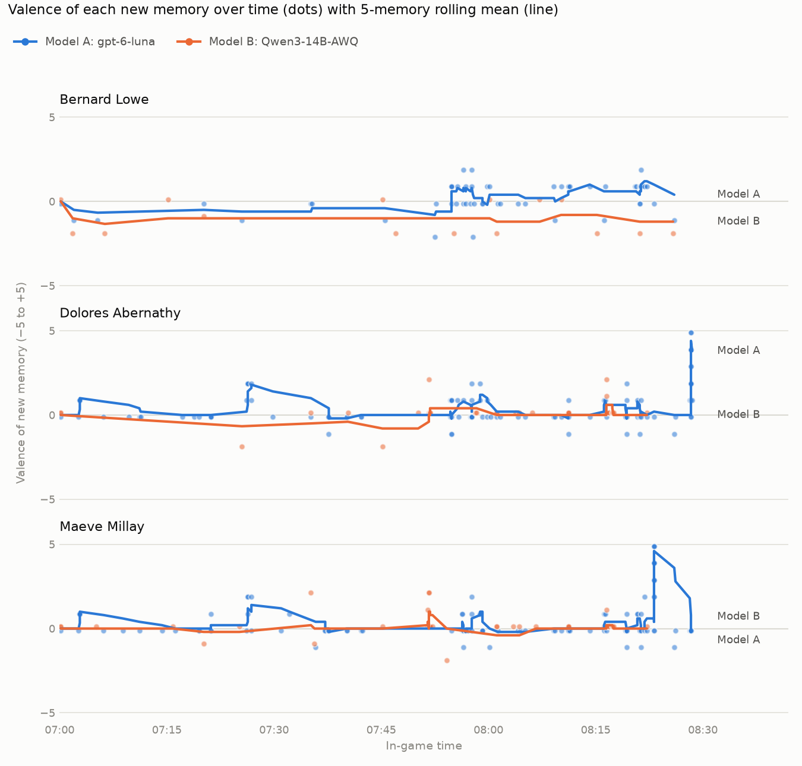

# Case Study 4: Answer Template

**Student name(s): Mateusz Wilk, Anna Marini**

**Student number(s): s4003748, s3888355**

**Date:**

**Models used:** Model A: openai/gpt-6-luna (via OpenRouter; embeddings: openai/text-embedding-3-small) | Model B: Qwen/Qwen3-14B-AWQ (local, vLLM; same embeddings)

---

## Exercise 1: Shaping Agent Personalities

### 1.1 Version 1

**Prompting style used** (e.g., adjectives only, full sentences, concrete examples): Trait adjectives in `innate` ("confrontational, demanding, highly critical"), plus a short, mostly positive career backstory in `learned` that frames his harshness as assertiveness ("not afraid to speak his mind or challenge others when necessary").

**`innate` field:**

> confrontational, demanding, and highly critical of others. He is a perfectionist and expects the same from those around him. He is also highly intelligent and analytical, with a keen eye for detail.

**`learned` field:**

> Bernard is a self-made man who has worked hard to build his career and reputation. He has learned to be assertive and confident in his abilities, and he is not afraid to speak his mind or challenge others when necessary.

**Sample conversation excerpts (2–3):**

*07:58, Bernard & Dolores, checking the café before opening (valence: Bernard +1, Dolores +1):*

> **Bernard:** Good morning, Dolores. We’re nearly set. Please check the opening checklist and make sure the espresso machine and front seating are ready before we unlock the doors.
>
> **Dolores:** Of course. I’ll check the espresso machine and front seating against the checklist now, and let you know when everything’s ready.
>
> **Bernard:** Good. Check both carefully, and tell me immediately if anything is out of order. We open at eight; I don’t want surprises.
>
> […]
>
> **Bernard:** All right. Test the machine through a full cycle, and check that it’s heating and pulling properly. Let me know as soon as you’ve finished.

*08:10, Bernard & Maeve (valence: Bernard +1, Maeve 0):*

> **Maeve:** Morning, Bernard. I’ve checked the espresso machine and grinder, and the counter’s clean. Is there anything else you’d like me to check before we open?
>
> **Bernard:** No. The seating is ready, and the machine passed its full-cycle test. You’ve checked the grinder and cleaned the counter; that’s sufficient. We’re opening now—get behind the counter and be ready for the first customers.

*08:29, Bernard & Dolores (valence: Bernard +1, Dolores −1):*

> **Bernard:** The first batch is underway, then? Keep an eye on the brew and tell me immediately if the espresso machine or grinder gives you any trouble. We open at eight; I expect everything ready before then.
>
> **Dolores:** Yes, Bernard. The first batch is underway, and I’ll keep an eye on the brew and let you know right away if the machine or grinder gives me any trouble.
>
> **Bernard:** Good. Once the brew is ready, check the seating and counter supplies one last time. I want everything in order before we unlock the doors.

### 1.2 Version 2

**Prompting style used:** Stronger, more extreme trait labels in `innate` ("unreasonable, stubborn, discriminatory", "psychopathic tendencies"), plus a psychological backstory in `learned` (unstable childhood, bullying, fear of failure) that explains *why* he is like this but does not describe how he behaves towards his staff.

**`innate` field:**

> unreasonable, stubborn and discrimnatory. He is of a perfectionist nature and very meticulous, which stems from his psychopathic tendencies.

**`learned` field:**

> Bernard went throguh a difficult childhood, changing households and schoolds many times, sometimes several times a year. He was bullied and ostracized by his peers, which led to him developing a strong sense of self-reliance and independence. He has a deep-seated fear of failure and rejection, which drives him to be highly competitive and ambitious in his career.

**Sample conversation excerpts (2–3):**

*08:06, Bernard & Maeve (valence: Bernard +1, Maeve +1):*

> **Bernard:** Good morning, Maeve. Once you’ve finished washing up, please check that your station is ready for opening.
>
> **Maeve:** Good morning, Bernard. I’ll finish washing up and check that my station’s ready for opening.
>
> **Bernard:** Thank you. Let me know if anything needs attention.

*08:11, Bernard & Dolores (valence: Bernard +1, Dolores +1):*

> **Bernard:** Good morning, Dolores. I see you’re stocking the cups and lids. Please make sure the counter is fully supplied before opening, and let me know when you’ve finished.
>
> **Dolores:** Good morning, Bernard. I’m finishing up the cups and lids now. I’ll let you know as soon as the counter is fully supplied.
>
> **Bernard:** Very good. Please check the rest of the service supplies as well, and let me know when the counter is ready.
>
> **Dolores:** Of course. I’ll check the rest of the supplies now and let you know as soon as the counter is ready.
>
> **Bernard:** Thank you. I’ll be at the counter; let me know as soon as you’ve finished the check.

*08:27, Maeve reporting to Bernard (valence: Bernard +1, Maeve +1):*

> **Maeve:** Morning, Bernard. I’ve finished washing up and checked my station. The espresso machine looks good, and the cups and lids are stocked. Dolores has the grinders ready too—I don’t see anything needing attention.

### 1.3 Version 3

**Prompting style used:** Concrete behavioural examples. `innate` is a plain list of adjectives, and `learned` describes specific actions towards Dolores and Maeve (never praising, interrupting, blaming them in front of customers, inspecting the counter) and includes example lines of dialogue for the model to imitate. Unlike v1 and v2, it contains no backstory explaining *why* Bernard behaves this way.

**`innate` field:**

> impatient, condescending, critical, controlling

**`learned` field:**

> Bernard Lowe manages Hobbs Cafe and is a difficult boss to Dolores and Maeve. He never praises their work and interrupts them mid-sentence. When something goes wrong he blames them in front of customers, saying things like "I have never seen anyone make a latte this badly" or "If you can't keep up, I'll find someone who can." He checks the counter every few minutes and points out every crumb and smudge.

**Sample conversation excerpts (2–3):**

*07:54, Bernard & Dolores on the way to work (valence: Bernard 0, Dolores −1):*

> **Dolores:** Good morning, Mr. Lowe. I’m heading in now—I'll get the counter ready when we arrive.
>
> **Bernard:** Good. Check the counter for crumbs and make sure the machines are ready before we open. I don’t want anything overlooked.

*07:56, Bernard & Maeve (valence: Bernard 0, Maeve −1):*

> **Maeve:** Good morning, Bernard. Dolores and I are on our way to the cafe now. We’ll be ready to get things set up when we arrive.
>
> **Bernard:** Good. Have Dolores get the counter set up, and make sure it’s free of crumbs. I’ll check that the machines are ready before we open. Don’t keep me waiting.
>
> **Maeve:** Understood. Dolores will handle the counter, and I’ll make sure it’s crumb-free. We’ll be there shortly.

*08:21, Bernard & Maeve (valence: Bernard +1, Maeve −1):*

> **Bernard:** Maeve, check the espresso machine’s pressure and the grinder settings before you call them ready. And make sure the counter’s free of crumbs—we’re opening.
>
> **Maeve:** Yes, Bernard. I’m checking the pressure and grinder settings now, then I’ll give the counter one last pass for crumbs before I call everything ready.
>
> **Bernard:** Don’t call it ready until you’ve actually tested it. Check the pressure gauge, run a little coffee through the grinder, and tell me when both are within spec.
>
> **Maeve:** I checked the pressure gauge and ran a little coffee through the grinder. Both are within spec, and the grounds look consistent. I’m giving the counter one last pass for crumbs now.

### 1.4 Analysis

*Setup: each version ran for 30 in-game minutes after opening (stopped at 08:30) in a fresh copy of `base_cafe_spiral`, with openai/gpt-6-luna. Each run produced exactly three conversations involving Bernard. Excerpts and numbers were extracted with `analysis/ex1_conversations.py --until 08:30`. Valence is the score (−5 to +5) the simulation's LLM gives each agent's memory of a conversation.*

| Version | Bernard's lines | Avg. words per line | Valence: Bernard | Valence: Dolores | Valence: Maeve |
|---|---|---|---|---|---|
| v1: trait adjectives + career backstory | 10 | 26.6 | +1.0 | 0 | 0 |
| v2: extreme labels + trauma backstory | 5 | 18.4 | +1.0 | +1 | +1 |
| v3: concrete behavioural examples | 4 | 25.5 | +0.3 | −1 | −1 |

**Which version produced the most confrontational Bernard? Which produced the least?**

Your answer: v3 (concrete behavioural examples) produced the most confrontational Bernard, and v2 (extreme labels plus a trauma backstory) the least. In v3, Bernard speaks in curt commands with an edge of distrust ("Don’t keep me waiting.", "Don’t call it ready until you’ve actually tested it."), never says please or thank you, and keeps returning to crumbs on the counter. v3 is also the only version where both baristas remembered their conversations with Bernard negatively (valence −1 in every one of their memories of him). v1 gives a demanding, micromanaging boss: he issues long lists of instructions and repeatedly says "tell me immediately", but he stays professional and polite ("Please check the opening checklist"). One barista memory was negative (Dolores, −1). v2 is the clearest failure: despite being described as "unreasonable", "discriminatory" and "psychopathic", Bernard is the most courteous of the three ("please", "Thank you", "Very good"), and both baristas rated every interaction with him positively (+1).

**Does Bernard's actual behaviour match what you wrote? Where is the gap largest?**

Your answer: Only partially, and the gap is largest in **v2**. None of its labels shows up in the dialogue: there is nothing unreasonable, discriminatory or psychopathic, and the trauma backstory (bullying, fear of rejection) leaves no visible trace. The model seems to have kept only the harmless part, "perfectionist and very meticulous", and turned it into a polite supervisor who asks for stock checks. In **v1**, "demanding" and "keen eye for detail" come through as micromanagement, but "confrontational" and "highly critical" do not: Bernard never criticises anyone, and the framing in `learned` ("assertive", "challenge others *when necessary*") gave the model a reason to read him as a firm but fair manager. In **v3**, the closest match, the gap is in *intensity*. The concrete habit ("points out every crumb and smudge") was reproduced almost literally, and the tone is impatient and controlling. But Bernard never insulted anyone, never interrupted, and never used anything like the example lines. Those were written as conditional on something going wrong ("When something goes wrong he blames them in front of customers…"), and in the first 30 minutes nothing went wrong and no customers had arrived, so the trigger never came up. Across all versions, Bernard's own memories stay positive (+0.3 to +1): even when the baristas experience him negatively, the model narrates Bernard as a reasonable manager.

**Which prompting style was most effective at overriding the LLM's tendency to be polite? Why do you think that is?**

Your answer: **Concrete behavioural examples (v3)** were the most effective, but even they only produced a mildly harsh boss rather than the confrontational one described. The reason for this could be that concrete behavior is easier to act on than adjectives like "critical". The model has to infer what behaviour to produce, and an instruction-tuned model resolves that ambiguity in a polite way, while a specific action or an example of tone can be copied directly. Second, extreme examples seem to trigger model's safeguards e.g. "Discriminatory" and "psychopathic" are the kinds of traits instruction tuning teaches models to avoid acting out.

Based on the conversation excerpts of v3 specifically, we can reason that it would be beneficial to add examples of Bernard's routine behavior as the specific trigger event (of something going wrong) may not always happen.

Finally, it is important to note the main limitation of this experiment: that it was a single 30-minute run, so some differences could be purely by chance.

---

## Exercise 2: Comparing Models

### 2.1 Models used

- Model A: `openai/gpt-6-luna`, a commercial API model accessed through OpenRouter.
- Model B: `Qwen/Qwen3-14B-AWQ`, an open-weights 14B model quantised to 4 bits (AWQ). It ran locally with vLLM 0.31 on an RTX 5070 Ti (16 GB), with Qwen's "thinking" mode disabled (`enable_thinking: false`) and a 12k-token context.

 Both runs lasted 30 in-game minutes after opening (stopped at 08:30). For Model A we reused the Exercise 1 v3 run, which already met these conditions: a fresh copy of `base_cafe_spiral`, this Bernard, and Model A. Logs: `logs/ex1_bernard_v3/` (Model A) and `logs/ex2_model_b_qwen/` (Model B).

**Which Bernard personality did you use (from Exercise 1)?** Version 3 (concrete behavioural examples), because it produced the most visible persona effect with Model A.

### 2.2 Qualitative comparison

**Do the agents sound different across models? Describe the differences in tone, vocabulary, and interaction style. Provide at least one conversation excerpt from each model.**

Model A excerpt (08:21, Bernard & Maeve):

> **Bernard:** Maeve, check the espresso machine’s pressure and the grinder settings before you call them ready. And make sure the counter’s free of crumbs—we’re opening.
>
> **Maeve:** Yes, Bernard. I’m checking the pressure and grinder settings now, then I’ll give the counter one last pass for crumbs before I call everything ready.
>
> **Bernard:** Don’t call it ready until you’ve actually tested it. Check the pressure gauge, run a little coffee through the grinder, and tell me when both are within spec.

Model A excerpt (07:57, Dolores & Maeve, for a like-for-like comparison with Model B):

> **Dolores:** Morning, Maeve. Glad we made it together. Let’s get inside and check the counter and machines before opening.
>
> **Maeve:** Morning, Dolores. I’ll check the counter and sweep away any crumbs while you check the machines. Then we should be set to open.
>
> **Dolores:** Sounds good. I’ll check the espresso machine and grinder, then we can open once you’ve finished sweeping.

Model B excerpt (08:16, Dolores & Maeve; under Model B, Bernard had no conversations at all):

> **Dolores:** Good morning, Maeve! I was just about to head out to work. Are you ready for the day too?
>
> **Maeve:** Good morning, Dolores! I’m just about ready. I was hoping to meet you at Hobbs Cafe today, as usual.
>
> **Dolores:** That sounds great, Maeve! I’ll see you there soon. Have a good day!
>
> **Maeve:** You too, Dolores! See you at Hobbs Cafe.

Your analysis: Yes, the two models produce very different agents, and the biggest difference is not tone but **whether the persona shows up at all**.

- **Model A** produces task-focused dialogue grounded in the café: espresso machine, grinder, pressure gauge, crumbs, cups. Lines are long and specific, and characters build on what the other just said. Bernard's v3 persona comes through as curt commands and distrust ("Don’t call it ready until you’ve actually tested it."). It even spills over to the baristas, who start talking about sweeping crumbs among themselves. Model A had 14 conversations, 3 of them with Bernard.
- **Model B** produces generic, small-talk dialogue with exclamation marks and stock phrases ("Good morning!", "Have a great day!", "See you at Hobbs Cafe."). It contains no café-specific vocabulary, and its 4 conversations were all between Dolores and Maeve: two near-identical greetings that arrange to meet at the café. **Bernard never spoke.** His harsh persona leaked out only indirectly, through how negatively he rated trivial observations: "the kitchen sink is unused" got −2, and "the refrigerator is opened" got −2.
- **Model B's planning was much less coherent.** Bernard went from the café's kitchen sink at 07:00 back to his own bathroom, then was at home by his closet from 08:05 to 08:20, after the café should have opened. Because the agents were rarely in the same place, conversations (which need co-location) almost never happened, and the persona had no stage to act on. As a result, Model B also made far fewer LLM calls and formed far fewer memories (741 calls and 86 memories, against 1,249 and 266 for Model A).

### 2.3 Valence comparison

*Each dot is one new memory (event, conversation or reflection) between 07:00 and 08:30, with the valence the model gave it. Lines are a 5-memory rolling mean. Produced by `analysis/ex2_compare_models.py`.*

| Valence, 07:00–08:30 | Model A: n | mean | SD | range | Model B: n | mean | SD | range |
|---|---|---|---|---|---|---|---|---|
| Bernard | 55 | +0.33 | 0.90 | −2 to +2 | 15 | −1.13 | 0.96 | −2 to 0 |
| Dolores | 104 | +0.77 | 1.31 | −1 to +5 | 33 | +0.03 | 0.72 | −2 to +2 |
| Maeve | 107 | +0.70 | 1.36 | −1 to +5 | 38 | +0.11 | 0.72 | −2 to +2 |
| **All agents** | 266 | +0.65 | **1.27** | −2 to +5 | 86 | −0.14 | **0.89** | −2 to +2 |
| *Events only* | 194 | +0.19 | 0.67 | −2 to +2 | 74 | −0.19 | 0.93 | −2 to +2 |
| *Reflections only* | 58 | +2.17 | 1.59 | 0 to +5 | 8 | 0.00 | 0.00 | 0 to 0 |

**Which model produces more emotional variance?**

Your answer: **Model A, overall** (SD 1.27 vs 0.89, range −2 to +5 vs −2 to +2), but the split by memory type shows *why*, and it is not simply "Model A is more emotional":

- **Model A's extra variance comes from reflections and conversations.** Its agents produced 58 reflection thoughts, mostly upbeat insights rated +2 to +5 (the spikes at about 08:23–08:28 for Dolores and Maeve), and 14 conversations. Model B's agents produced only 8 reflections, all rated exactly 0, and 4 conversations. Reflection is triggered by accumulated importance, so fewer interactions also meant fewer reflections.
- **On plain perceived events, Model B is actually *more* volatile** (SD 0.93 vs 0.67). Its ratings are polarised: mostly 0, with a cluster of −2s for neutral observations.
- **The models disagree on the persona's emotional colour.** Model B made Bernard consistently negative (mean −1.13; 9 of 15 memories negative), while Model A kept him slightly positive (+0.33). So Model B expressed Bernard's negativity through *how he felt* about mundane events, whereas Model A expressed it through *what he said* to his staff.

### 2.4 JSON validation failures

| | Model A | Model B |
|---|---|---|
| Total LLM calls | 1,249 | 741 |
| Failed validations | 0 (unparseable JSON: 0, schema violations: 0, semantic validation: 0) | 0 (unparseable JSON: 0, schema violations: 0, semantic validation: 0) |
| Failure rate | 0.0% | 0.0% |

*Counted from the `llm_retry` and `llm_call_fail` entries in each `run.jsonl`, by `analysis/ex2_compare_models.py`.*

**What does this tell you about using different models in agent simulations?**

Your answer: Neither model produced a single failed validation, including the Qwen local model. This is mostly explained by the server design, not by the models being equally good at JSON. Every request uses **strict JSON-schema structured output**. On vLLM this is enforced by constrained decoding: the model can only emit tokens that keep the output valid against the schema, so malformed JSON is close to impossible. OpenRouter/OpenAI does the same for Model A. It does not mean that the models are able to produce equivalent behavior since neither has shown any errors in our runs and model B as mentioned before has problems with consistent planning e.g. with Bernard being in his home around 8 when cafeteria was already open, also failing to produce a single conversation invloving Bernard.

### 2.5 Reflection

**The architecture and personality descriptions are identical. What does it mean that behaviour differs anyway?**

Your answer: It means the LLM is not an unbiased executor of the architecture, it is a large part of the simulation's dynamics. Everything that defines behaviour here (planning the day, choosing where to go, deciding whether to talk) is delegated to the model. A different model therefore produces a different world. With Model A, the café ran as a café and Bernard behaved like a strict manager. With Model B, the same prompts produced agents who wandered, barely met, and greeted each other in generic phrases. This shows that each model likely inhibits its own biases from its training pipeline, with model A being more task-oriented and model B more generic and suitable for cheerful small talk instead. Also model capabilities limit how well the simulation can work, if it cannot plan coherently enough for the agents to meet (model B) the resulting number of events will be far lower which can make it difficult to interpret the impact on the characters' emotions.

As in Task 1, this is a very limited study with a single 30-minute experimental repetition per model (GPT-6 Luna and Qwen3-14B-AWQ).

---

## Exercise 3: Enabling the Negativity Bias

The negativity bias consists of two mechanisms:

   - **Valence-weighted retrieval:** The standard architecture retrieves memories based on recency, relevance, and importance only (the valence weight is set to zero). To enable valence-aware retrieval, the agent needs a non-zero valence weight. The negativity bias multiplier controls how much more strongly negative memories are favoured over positive ones during retrieval — a value of 1.5 means negative memories are retrieved 1.5× more readily.

   - **Asymmetric sensory encoding:** When enabled, negatively valenced events (≤ −3 on a −10 to +10 scale) are stored with expanded perceptual detail (richer descriptions of what the agent expereinced). When disabled, all events are stored with the same level of detail regardless of valence.

   Look at Dolores's `scratch.json` file. Find the fields that control these mechanisms and set them appropriately. Maeve's scratch file should remain unchanged — she is your control.

**Which Bernard personality did you use (from Exercise 1, the one you used in Exercise 2)? Paste his `innate` and `learned` fields.**

Your answer:

### 3.1 Valence trajectories

(Attach or paste your plot of Dolores vs Maeve valence over time)

### 3.2 Descriptive statistics

| Agent | Overall valence | Thought valence |
|---|---|---|
| Dolores (neg. bias) | | |
| Maeve (control) | | |

**Cohen's d:**

**Interpretation (small / medium / large effect):**

### 3.3 Thought description comparison

**Dolores example thought (negative memory):**

>

**Maeve example thought (comparable event):**

>

**Is Dolores's description longer and more sensorially detailed?**

Your answer:

### 3.4 Memory intrusion check

If your simulation included off-duty hours, answer the following. If not, write "Simulation was too short to observe off-duty reflections."

**Did you find work-related content in Dolores's evening reflections? Paste any examples:**

>

**Did you find work-related content in Maeve's evening reflections? Paste any examples:**

>

**Is there a difference between the two agents?**

Your answer:

### 3.5 Consistency across runs (if applicable)

| Run | Dolores valence | Maeve valence | Cohen's d |
|---|---|---|---|
| Run 1 | | | |
| Run 2 | | | |
| Run 3 | | | |

### 3.6 Tracing the mechanism

**You enabled two changes: negative memories get higher retrieval scores, and negative events get stored with more detail. Looking at your logs, can you trace how these two changes could lead to the valence decline you observed? Think about what happens when a negatively-toned reflection gets stored as a new memory.**

Your answer:

---

## Exercise 4: Daily Plan Quality

### 4.1 Original plan problems

**Paste an example of a problematic daily plan and annotate what is wrong with it:**

>

### 4.2 Your planning rules

List the rules you wrote:

1.
2.
3.
4.
5.

### 4.3 Improved plan

**Paste an example of a daily plan generated with your rules:**

>

### 4.4 Downstream effects

**Do agents with better plans behave differently? More social interactions? Different valence patterns?**

Your answer:

---

## General Reflection

**What was the most surprising finding across all exercises?**

Your answer:

**If you were designing an agent simulation for a real application, what would you do differently based on what you learned?**

Your answer:
